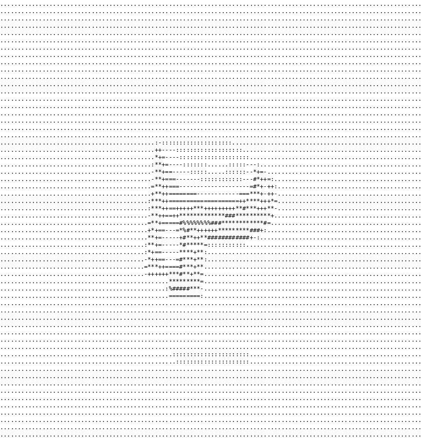
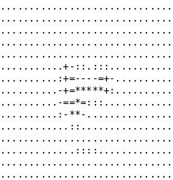
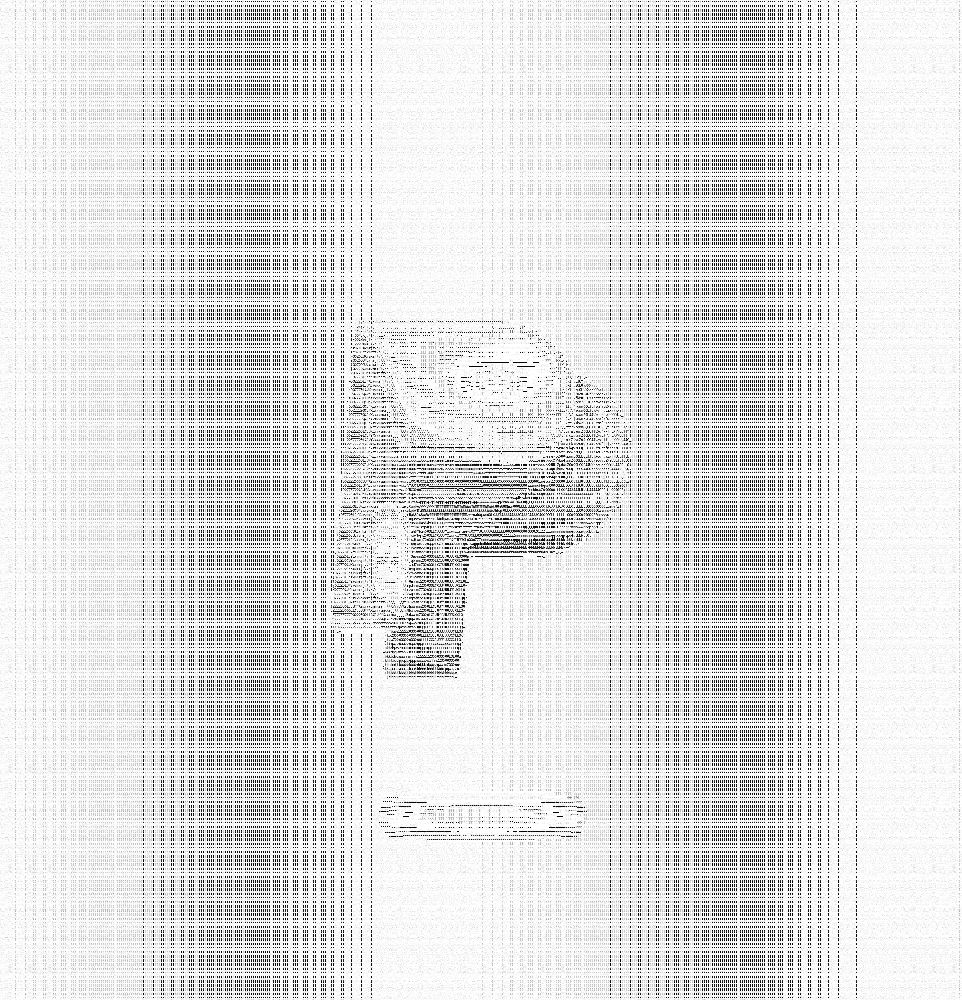

# img2ascii #

**Version:** 2.0.0 \
**License:** MIT

## Overview ##

`img2ascii` is a `Python` library and command-line tool for converting images to `ASCII` art. It loads images from local files or `URLs`, offers two character sets for different levels of detail, and supports both printing `ASCII` art to the terminal and saving the result as an image file.

## Features ##

- Loads images from local files and `http`/`https` `URLs`
- Two character sets: a **10**-character simple set and a **68**-character advanced set
- Adjustable scale, from **0** to **6**
- Optional brightness inversion for light text on a dark terminal
- Saves the `ASCII` art as an image file, with overwrite protection
- Size limits that reject oversized or malformed images **before their pixels are decoded**

## Requirements ##

- `Python` **3.12** or newer
- `numpy`, `Pillow`, `requests` and `urllib3`, installed automatically

## Installation ##

Install the package with `pip`, run from the project root folder:

```bash
pip install .
```

## Supported Formats ##

- **Input:** `JPEG`, `PNG`, `WebP`, `TIFF`, `BMP` and `PPM`/`PGM`/`PBM`, including `MPO` photos from some phones and cameras. The format is **detected from the file content**, not from its extension.
    > ℹ️ **INFO** `ICO` files can be **saved but not loaded**, because `Pillow` decodes their pixels while opening them, before any size check can run.
- **Output:** chosen by the extension of the output file: `.jpg`, `.jpeg`, `.mpo`, `.png`, `.webp`, `.tif`, `.tiff`, `.bmp`, `.ppm`, `.pgm`, `.pbm` or `.ico`.

## CLI Usage ##

> ℹ️ **INFO** The `CLI` **always averages each pair of rows** (`skip_rows=True`), because a character is roughly twice as tall as it is wide.

Once installed, the tool can be run from the terminal as `img2ascii` or as `python -m img2ascii`. Example paths are shown for `Linux`, as CLI works the same for `Windows` and `Linux`.

- Convert a local image and print the `ASCII` art to the terminal:

    ```bash
    img2ascii -f ~/photos/demo.jpg
    ```

- Convert an image from a `URL`:

    ```bash
    img2ascii -u https://example.com/image.png
    ```

- Save the `ASCII` art as an image file:

    ```bash
    img2ascii -f ~/photos/demo.jpg -o ascii_art.png
    ```

- Use the advanced character set with a lower detail level:

    ```bash
    img2ascii -f ~/photos/demo.jpg -a -s 4
    ```

- Overwrite an existing output file:

    ```bash
    img2ascii -f ~/photos/demo.jpg -o ascii_art.png --overwrite
    ```

- Print dark text for a light terminal theme:

    ```bash
    img2ascii -f ~/photos/demo.jpg --no-invert
    ```

- Follow redirects when downloading:

    ```bash
    img2ascii -u https://example.com/image.png --allow-redirects
    ```

All options:

- `-f, --file <path>` - path to a local image file; **either `-f` or `-u` is required**.
- `-u, --url <url>` - `URL` of the image, `http` or `https` only.
- `-s, --scale <n>` - scale from **0** to **6**, default **2**. One character covers a `2^n` x `2^n` pixel block, so a higher scale gives a smaller, less detailed result.
- `-a, --advanced` - use the advanced character set.
- `-o, --output <path>` - save the result to an image file instead of printing it.
- `--font-size <n>` - font size in pixels of the saved image, default **12**.
- `--overwrite` - replace the output file if it already exists.
- `--allow-redirects` - follow `HTTP` redirects, which are **blocked by default**.
- `--invert` / `--no-invert` - invert brightness. **On by default when printing** (light text on a dark terminal), **off by default when saving** (black text on white).

Exit codes:

- `0` - success.
- `1` - an error *(unreadable file, failed download, unsupported format, ...)*.
- `2` - invalid arguments.

## Library Usage ##

Use the `ImgConverter` class from your own `Python` scripts:

```python
from img2ascii import ImgConverter

conv = ImgConverter()
```

> ⚠️ **WARNING** `load_from_url` fetches **any `http`/`https` address** it is given, including private, loopback and link-local ones *(e.g. `127.0.0.1`, `192.168.x.x`, `169.254.169.254`)*. If `URLs` come from untrusted users, **validate them in your application** before calling it, and keep `allow_redirects=False` (the default), because **redirect targets are not checked**.

> ℹ️ **INFO** `load_from_url` honours the proxy variables (`HTTP_PROXY`, `HTTPS_PROXY`, `NO_PROXY`) and the `CA` bundle variables (`REQUESTS_CA_BUNDLE`, `CURL_CA_BUNDLE`), but **never sends credentials from `~/.netrc`**.

Load an image from a file or a `URL`:

```python
conv.load_from_file("~/photos/demo.jpg")
conv.load_from_url("https://example.com/image.png")
```

Get the result in the form you need:

```python
img_array = conv.get_array() # as a numpy array
img_string = conv.get_string() # as a string ready for printing
conv.print_ascii() # print to the terminal
conv.save_to_img() # save as an image
```

Pass conversion options to any of the four methods:

```python
conv.print_ascii(scale=3, advanced_set=True, invert=True)
conv.save_to_img("ascii_art.png", overwrite=True, scale=3, font_size=14)
```

All four methods take the same conversion arguments:

- `scale` - from **0** to `ImgConverter.MAX_SCALE` (**6**), default **2**. A value outside this range is **clamped** and a `UserWarning` is issued.
- `advanced_set` - use the advanced character set, default `False`.
- `skip_rows` - average each pair of rows, which halves the height. Default `True`, **except in `get_array`**, where it is `False`.
- `invert` - invert brightness, default `False`.

`save_to_img` also takes:

- `out_path` - path of the output file, default `ascii.png`.
- `overwrite` - replace the output file if it already exists, default `False`.
- `font_size` - font size in pixels, default **12**.

Notes:

- The result is **cached**, so calling a method again with the same arguments does not convert the image again.
- `get_array` **returns a copy**, so changing it does not affect the converter.
- Arguments of the wrong type raise `TypeError`.
- `save_to_img` uses the first monospaced font it finds: `Courier New`, `DejaVu Sans Mono`, `Liberation Mono`, `Menlo` or `Consolas`. If none is installed, it falls back to the built-in `Pillow` bitmap font, which has a single size and **ignores `font_size`**.

## Example Results ##

### Input image ###

<div align="center">
  
</div>

Photo by [Farhat Altaf](https://unsplash.com/@farhat099?utm_content=creditCopyText&utm_medium=referral&utm_source=unsplash) on [Unsplash](https://unsplash.com/photos/a-blue-object-floating-in-the-air-fQ4ESXr-pNI?utm_content=creditCopyText&utm_medium=referral&utm_source=unsplash)

### Scaling ###

Scale **2**:

<div align="center">
  
</div>

Scale **4**:

<div align="center">
  
</div>

Scale **6**:

<div align="center">
  
</div>

### Character sets ###

Simple set:

<div align="center">
  
</div>

Advanced set:

<div align="center">
  
</div>

## Limits ##

- Images can have at most **8,847,360** pixels (`DCI 4K`, `4096x2160`).
    > ℹ️ **INFO** For images above about **89** million pixels, `Pillow` prints its own `DecompressionBombWarning` before `img2ascii` rejects the image.
- Files and downloads can be at most **70,778,880** bytes (about **67.5** MiB). `JPEG` files are limited to **30** MiB, because the `Pillow` `JPEG` decoder can use **many times the file size in memory** on crafted files.
- A download is aborted after **15** seconds in total.
- Redirects are **blocked** unless `allow_redirects=True` (`--allow-redirects` in the `CLI`) is set.
- An image smaller than one block at the chosen scale gives an empty result and raises `ValueError`. Use a lower scale for small images.

## Error Handling ##

All custom exceptions derive from `ImgConverterError`, so `except ImgConverterError` catches every one of them:

- `ImgConverterError` - base class. Also raised directly when an image exceeds a limit or cannot be decoded.
- `ImageNotLoadedError` - no image loaded.
- `InvalidURLError` - the `URL` cannot be parsed or does not use `http`/`https`.
- `UnsupportedExtensionError` - unsupported input format or output file extension.
- `ImageDownloadError` - the download failed, timed out, was redirected while redirects are blocked, returned something other than an image, or the file is too large or failed verification.
- `TargetExistsError` - output file already exists and `overwrite` is off.

Standard exceptions are used for the rest:

- `TypeError` - an argument has the wrong type.
- `ValueError` - `font_size` is not greater than **0**, or the image is too small for the chosen scale.
- `FileNotFoundError` - the input file does not exist.
- `OSError` - a file cannot be read or written *(e.g. a missing output directory or no permission)*.
- `RuntimeError` - a path starts with `~user` for a user that does not exist.

## Contributing ##

Feel free to fork this project and make pull requests if you find bugs or have ideas for new features.

## License ##

This project is licensed under the MIT License. See the `LICENSE` file for details.
